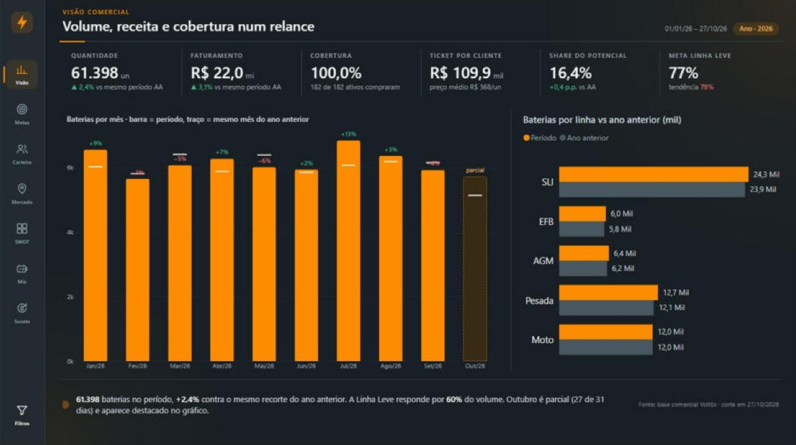
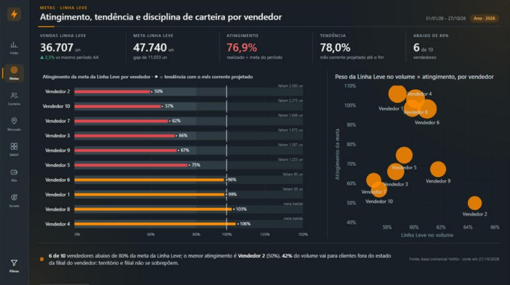
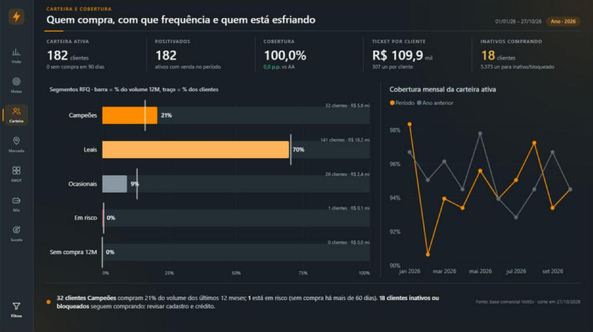
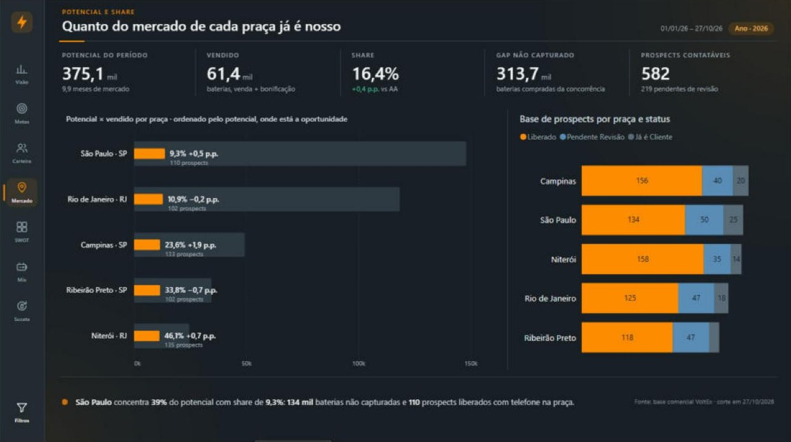
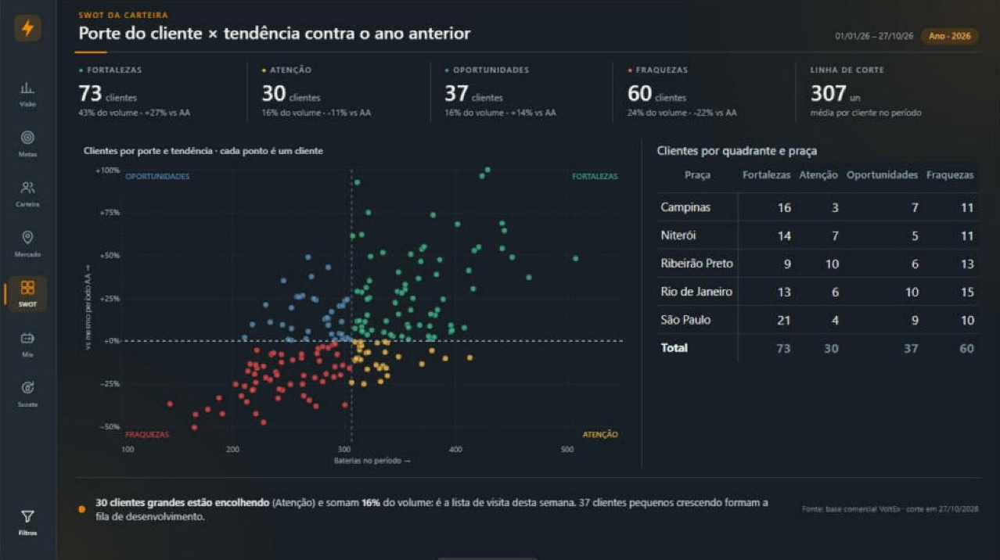
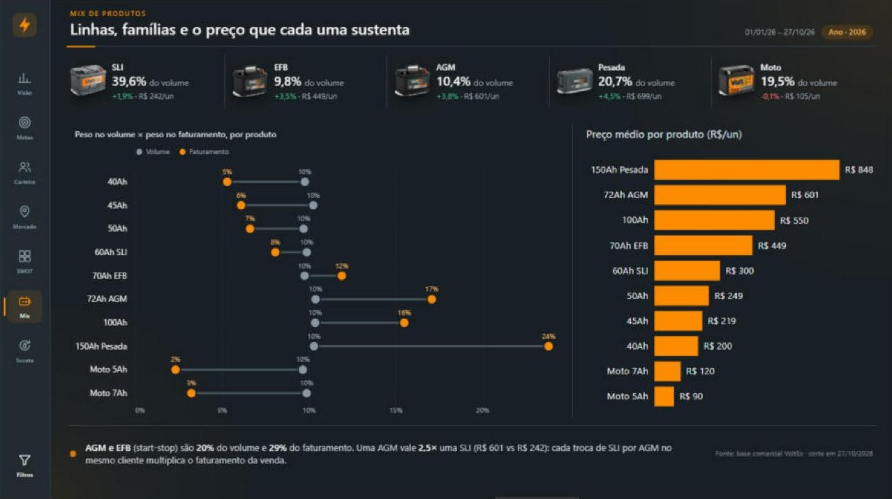
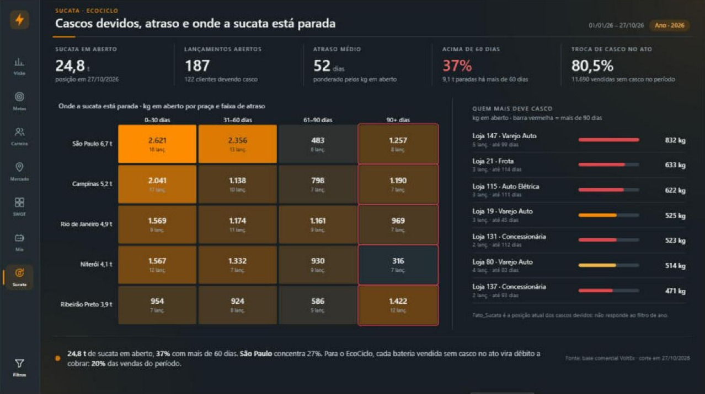
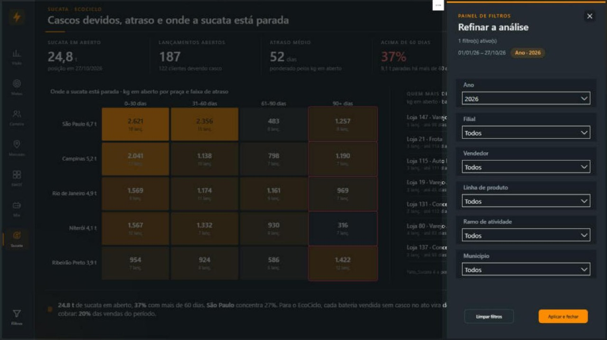
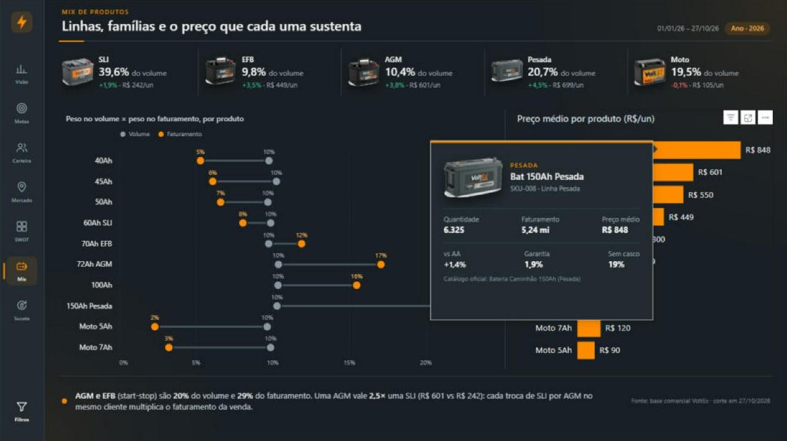

# VoltEx Comercial — Projeto Power BI (.pbip)


Dashboard de performance comercial da VoltEx Baterias (marca fictícia, dados simulados): volume e faturamento, metas da Linha Leve por vendedor, cobertura e segmentação RFQ da carteira, share sobre o potencial de cada praça, SWOT de clientes, mix de produtos e sucata do programa EcoCiclo. Modelo em **TMDL**, relatório em **PBIR**, versionado em Git.

## Telas

| | |
|---|---|
|  |  |
| **1 · Visão Comercial** — volume, receita, cobertura, share e meta num relance; mês parcial destacado. | **2 · Metas de Vendas** — atingimento por vendedor com régua de 80% / 100% e tendência do mês corrente. |
|  |  |
| **3 · Carteira e Cobertura** — segmentos RFQ: quem compra muito, quem compra pouco, quem está esfriando. | **4 · Potencial e Share** — quanto do mercado de cada praça já é VoltEx e onde estão os prospects. |
|  |  |
| **5 · SWOT da Carteira** — cada ponto é um cliente: porte × crescimento contra o ano anterior. | **6 · Mix de Produtos** — catálogo com fotos, peso no volume × peso no faturamento e preço médio. |
|  |  |
| **7 · Sucata EcoCiclo** — cascos devidos por praça e faixa de atraso, e quem mais deve. | **Painel de filtros** — gaveta lateral com 6 filtros sincronizados e a trilha dos filtros ativos. |

<p align="center"><br><em>Tooltip de produto com foto, catálogo oficial e indicadores do SKU.</em></p>

## Abrir

1. Clone o repositório e abra `VoltEx.Comercial.pbip` no Power BI Desktop.
2. Aponte os dois parâmetros para a pasta onde você clonou, em **Transformar dados › Gerenciar parâmetros**:
   - **CaminhoBaseCom** → `<sua pasta>\Base_VoltEx_Comercial.xlsx` (vendas, metas, carteira, potencial, sucata, prospects).
   - **CaminhoBaseFab** → `<sua pasta>\Base_VoltEx_Dashboard_Completo.xlsx` (só o catálogo oficial de produtos).
   O padrão aponta para `E:\Projetos BI\14 - Voltex baterias\`.
3. Clique em **Atualizar**. Os visuais **HTML Content** e **Deneb** vêm do AppSource: o Desktop precisa estar conectado a uma conta Power BI na primeira abertura.

## Estrutura

```text
VoltEx.Comercial.pbip
VoltEx.Comercial.SemanticModel/definition/
├── model.tmdl · relationships.tmdl · expressions.tmdl (CaminhoBaseCom, DataCorte)
└── tables/  Dim_Calendario · Dim_Catalogo (produtos oficiais) · Dim_Produto (SKUs, fotos base64) · Dim_Filial · Dim_Vendedor · Dim_Municipio · Dim_Cliente
             Fato_Vendas · Fato_Metas · Fato_Sucata · Fato_Prospects
             Seg_RFQ · Seg_SWOT (desconectadas)
             _Medidas (99 medidas, pastas 01–07 e 91 HTML)
VoltEx.Comercial.Report/
├── definition/pages/      Capa + 7 abas + 3 tooltips (TT Mês, TT Vendedor, TT Produto)
├── definition/bookmarks/  14 indicadores (abrir/fechar o drawer de filtros por aba)
└── StaticResources/       tema VoltEx_Com_Theme + fundos (mesmo desenho da Distribuidora)
VoltEx.Comercial.Build/    scripts Python que geram modelo e relatório
```

Relacionamentos 1:N e unidirecionais. Produto em cadeia: `Dim_Catalogo → Dim_Produto → Fato_Vendas`. Geografia em cadeia: `Dim_Municipio → Dim_Cliente → Fato_Vendas / Fato_Sucata`, e `Dim_Municipio → Fato_Prospects`.

## Páginas

| # | Página | Visual principal | Apoio | Tooltip |
|---|---|---|---|---|
| 0 | Capa | HTML com filiais, carteira e praças | botão INICIAR | — |
| 1 | Visão Comercial | Evolução mensal vs AA, mês parcial destacado (Deneb) | Barras por linha vs AA | TT Produto |
| 2 | Metas de Vendas | Bullet de atingimento + ◆ tendência (Deneb) | Dispersão peso da Linha Leve × atingimento | TT Vendedor |
| 3 | Carteira e Cobertura | Segmentos RFQ: % volume × % clientes (Deneb) | Cobertura mensal vs AA | TT Mês |
| 4 | Potencial e Share | Potencial × vendido por praça (Deneb) | Prospects por praça e status | — |
| 5 | SWOT da Carteira | Quadrante porte × tendência, 1 ponto por cliente (Deneb) | Matriz praça × quadrante | — |
| 6 | Mix de Produtos | Volume × faturamento por produto (dumbbell, Deneb) | Preço médio por produto | TT Produto (com foto) |
| 7 | Sucata EcoCiclo | Heatmap praça × faixa de atraso (Deneb) | Ranking HTML de quem mais deve casco | — |

Em todas as abas: header HTML com trilha de filtros, faixa de KPIs em HTML, insight automático no rodapé e drawer com 6 filtros sincronizados (Ano, Filial, Vendedor, Linha, Ramo, Município). O Ano abre em 2026.

## Regras de negócio

| Item | Como |
|---|---|
| Data de corte | `DataCorte` = hoje. A base traz vendas até 31/12/2026: tudo depois de hoje é cortado. O calendário termina no corte, então o ano corrente já é YTD e o AA compara o mesmo recorte de dias (deslocamento explícito com `EDATE -12`: o `SAMEPERIODLASTYEAR` estendia o AA até 31/10 e inflava a base em 862 un). Para congelar um fechamento, troque por `#date(2026, 9, 30)`. |
| Quantidade | Venda + bonificação. Troca em garantia fica fora (tem medida própria). |
| Meta Linha Leve | Grão vendedor × mês, só a Linha Leve (40–72Ah: SLI, EFB, AGM). Em branco com filtro de produto, cliente ou município. Tendência projeta o mês parcial linearmente. |
| Cobertura | Clientes **ativos** que compraram ÷ carteira ativa do vendedor (carteira via `TREATAS`, sem caminho ambíguo). |
| RFQ | Recência, frequência (meses com compra) e quantidade dos 12 meses até o fim do período. Média de referência = base inteira, então o segmento de um cliente não muda com o filtro. |
| Potencial / Share | Potencial mensal × meses equivalentes (mês parcial conta pelos dias). Em branco com filtro de vendedor, filial, linha ou ramo: potencial é de mercado, não se reparte. |
| SWOT | Porte = quantidade no período vs média por cliente; tendência = vs mesmo período AA. |
| Sucata | Posição na data de corte (não responde ao filtro de ano). `Dias_Atraso` recalculado no Power Query: o da origem estava congelado na data de geração e tinha valores negativos. |
| Marca | Só VoltEx. A família (Linha Leve, Pesada, Moto) é derivada da linha técnica no Power Query e qualquer coluna de marca da origem é descartada, então marca de terceiro não aparece nem se a base for regerada pelo script antigo. |
| Catálogo oficial | Os 10 SKUs comerciais apontam para os 6 produtos oficiais da base da fábrica: 40–60Ah → Carro 60Ah (Convencional); 70Ah EFB e 72Ah AGM → Carro 72Ah (Start-Stop); 100Ah e 150Ah → Caminhão 150Ah (Pesada); Moto 5Ah e 7Ah → Moto 7Ah (Convencional). 40–50Ah não existem no catálogo: o 60Ah é aproximação. Moto 9Ah AGM e Trator 220Ah ficam sem venda. Vendas, clientes e período da fábrica (2022–2025) não são usados. |
| Fotos | Catálogo VoltEx em base64, pela foto do produto oficial de cada SKU. |

## Números de referência (01/01–27/10, conferidos em pandas sobre a base)

| Medida | 2025 | 2026 |
|---|---:|---:|
| Quantidade | 59.959 | 61.398 |
| Faturamento | R$ 21,32 mi | R$ 21,99 mi |
| Qtd Linha Leve | 35.809 | 36.707 |
| Meta Linha Leve (jan–out) | — | 47.740 |
| Sucata em aberto (27/10/2026) | | 24.419 kg em 185 lançamentos |

## Pendências conhecidas

- **Validação no Desktop (27/10/2026)**: aberto, atualizado e conferido no Desktop. Todas as 99 medidas calculam; Quantidade 61.398, AA 59.959 (+2,4%), meta da Linha Leve 47.740 batem com a referência em pandas.
- **Clientes inativos/bloqueados comprando**: a base tem vendas para eles. A aba 3 sinaliza; é questão de cadastro e crédito, não de modelo.
- **Território × filial**: vendedores da Matriz SP vendem para o RJ e vice-versa. O potencial por praça não se reparte por filial por isso.
- **Navegação no modo de edição**: botões e menu exigem Ctrl+clique.
- **Base de origem**: `Base_VoltEx_Comercial.xlsx` é a cópia da base comercial com as famílias VoltEx no lugar das marcas de terceiros. O script gerador original ainda grava essas marcas; o modelo as descarta de qualquer forma.
